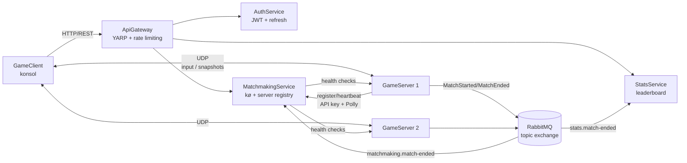

# Online Arena – prototype til eksamensprojekt (USS & Systemintegration)

Et simpelt multiplayerspil, hvor spillerne samler mønter (`$`) i en 2D-arena. Spillet er bevidst simpelt,
fordi investorerne interesserer sig for **infrastrukturen**. Prototypen viser skalering, robusthed,
messaging, authentication og CI/CD i en microservice-arkitektur bygget i .NET 10.

## Arkitektur



| Service | Ansvar | Kommunikation | Skalering |
|---|---|---|---|
| **ApiGateway** | Én indgang, routing, rate limiting, correlation id | REST (YARP) | X-akse (stateless) |
| **AuthService** | Registrering, login, JWT, refresh-token-rotation | REST | X-akse (kræver delt DB i prod) |
| **MatchmakingService** | Kø, server-registry, health-check-invoker, allokering | REST + events | Y-akse; Z-akse pr. region |
| **GameServer** | Autoritativ simulation, 20 Hz tickrate | UDP + events | X-akse: flere instanser = flere matches |
| **StatsService** | Read model / leaderboard ud fra events | RabbitMQ-consumer + REST | Uafhængig af spillets drift |
| **GameClient** | Prediction, reconciliation og interpolation | REST + UDP | – |

## Kør hele systemet (Docker)

```bash
cp .env.example .env            # valgfrit – ellers bruges udviklings-defaults
docker compose up --build
```

Start derefter **to** klienter i hver sin terminal, fordi der skal to spillere til et match:

```bash
dotnet run --project src/GameClient            # bruger http://localhost:8080
```

Indtast et nyt brugernavn og en adgangskode (mindst 6 tegn). Brugeren oprettes automatisk.

| URL | Hvad |
|---|---|
| http://localhost:8080 | API Gateway (eneste HTTP-indgang) |
| http://localhost:8080/api/stats/leaderboard | Leaderboard |
| http://localhost:8080/api/matchmaking/recent-matches | Seneste matches |
| http://localhost:15672 | RabbitMQ management (`game` / `game-dev-password`) |

**Styring i klienten:** WASD/piletaster, **P** slår prediction til/fra, **I** slår interpolation til/fra
og **Q** afslutter. Slå P fra for at mærke input-lag. Det er godt materiale til den mundtlige eksamen.

### Fejl-eksperimenter (robusthed)

```bash
docker compose stop gameserver-1     # matchmaking markerer serveren usund og bruger gameserver-2
docker compose stop rabbitmq         # spillet kører videre; events buffers i outboxen
docker compose start rabbitmq        # events leveres, og leaderboardet opdateres
docker compose stop stats            # beskeder venter i køen "stats.match-ended"
```

## Kør lokalt uden Docker (debugging)

Start RabbitMQ: `docker run -d -p 5672:5672 -p 15672:15672 rabbitmq:4-management`.
Kør derefter hver service med `dotnet run --project src/<Service>`. Development-profilen bruger
portene 5000–5003 og 5100. Start klienten med `dotnet run --project src/GameClient http://localhost:5000`.
OpenAPI/Scalar findes på `/scalar` på hver service i Development.

> Lokalt kan du kun køre én gameserver ad gangen, medmindre du ændrer `GameServer__UdpPort`.

## Tests

```bash
dotnet test OnlineArena.slnx --filter "Category!=E2E"         # unit-, API-, UDP- og integrationstests

# End-to-end mod hele systemet (korte matches via overlay-filen)
docker compose -f docker-compose.yml -f tests/e2e/docker-compose.e2e.yml up -d --build --wait
E2E_GATEWAY_URL=http://localhost:8080 dotnet test tests/OnlineArena.Tests --filter "Category=E2E"
docker compose -f docker-compose.yml -f tests/e2e/docker-compose.e2e.yml down -v

docker run --rm --network host -v "$PWD/tests/load:/scripts" grafana/k6 run /scripts/auth-rate-limit.js
```

I PowerShell sættes variablen med `$env:E2E_GATEWAY_URL = "http://localhost:8080"`.
Integrationstestene (kategori `Integration`) starter selv en RabbitMQ-container med Testcontainers og springes over,
hvis Docker ikke kører. I CI er `REQUIRE_DOCKER_TESTS=true` sat, så de fejler i stedet for at blive sprunget over.
E2E-testene springes over, medmindre `E2E_GATEWAY_URL` er sat.

`--network host` virker på Linux, som i CI-pipelinen. På Windows og Mac skal du i stedet køre scriptet med
`-e GATEWAY=http://host.docker.internal:8080`.

| Testtype | Hvor | Hvad testes |
|---|---|---|
| Unit | `tests/OnlineArena.Tests` | Spilregler, idempotens, matchmaking, tokens/JWT, outbox, prediction/reconciliation, codec |
| API (in-process) | `tests/OnlineArena.Tests/Api` | Auth-, matchmaking- og stats-endpoints via `WebApplicationFactory`: autorisation, API-nøgle, validering, health |
| Gameserver over UDP | `tests/OnlineArena.Tests/GameLoopUdpTests.cs` | Rigtigt game loop over UDP med styret tid: join/JWT-afvisning, fuld server, reconnect, input-begrænsning, timeout, ugyldige pakker, match-livscyklus og events |
| Integration (`Integration`) | `tests/OnlineArena.Tests/Messaging` | Rigtig RabbitMQ (Testcontainers): pub/sub til flere services, dubletter, dead-letter, retry, outbox relay og broker-udfald |
| E2E (`E2E`) | `tests/OnlineArena.Tests/E2E` + CI-jobbet `e2e-test` | Registrér → kø → match over UDP → MatchEnded via RabbitMQ → statistik, alt gennem gatewayen |
| Load/adfærd | `tests/load/auth-rate-limit.js` (k6) | Gatewayens rate limit (10 × 200/401, 2 × 429) |
| Smoke | `.github/workflows/ci.yml` | Hele systemet startes med `compose --wait` og kaldes gennem gatewayen |
| *Forslag* | – | Pact contract tests (gameserver ↔ matchmaking) |

## Pensum → kode (til rapporten)

| Begreb | Fil |
|---|---|
| REST, DTO'er, statuskoder, OpenAPI/Scalar | `src/*/Controllers/*.cs` |
| API key (service-til-service) | `src/Shared/Auth/InternalApiKeyAttribute.cs` |
| JWT, roller, refresh tokens med rotation | `src/AuthService/Services/*.cs`, `src/Shared/Auth/JwtOptions.cs` |
| API gateway + rate limiting (fixed/sliding window, partitioner) | `src/ApiGateway/Program.cs` |
| Typed client + Polly (retry, backoff, jitter, circuit breaker, timeout) | `src/GameServer/Program.cs`, `Networking/MatchmakingClient.cs` |
| Service discovery: self-registration + health-check-invoker | `MatchmakingService/Domain/ServerRegistry.cs`, `Workers/Workers.cs` |
| Liveness/readiness | `src/Shared/Hosting/HealthAndLogging.cs` |
| Topic exchange, publish/subscribe (to køer, samme event) | `Shared/Messaging/*`, begge `MatchEndedConsumer` |
| Publisher confirms, persistente beskeder | `Shared/Messaging/EventPublisher.cs` |
| Manuel ack, prefetch, dead-letter queue / invalid message channel | `Shared/Messaging/RabbitConsumerBase.cs` |
| Idempotent consumer | `StatsService/Domain/StatsStore.cs` |
| Outbox + message relay | `GameServer/Networking/EventOutbox.cs` |
| Autoritativ server, tickrate, snapshots, input-rate-limit | `GameServer/Game/GameLoop.cs` |
| Client-side prediction, reconciliation, entity interpolation | `GameClient/NetcodeHelpers.cs` |
| Send–vent–process (202 Accepted + polling) | `MatchmakingController.Enqueue` |
| CQRS-read-model | `StatsService` (bygges kun ud fra events) |
| Correlation id + strukturerede JSON-logs | `UseCorrelationId()` + `appsettings.json` |
| CI/CD, multi-stage Docker | `.github/workflows/ci.yml`, `Dockerfile` |

## Bevidste forenklinger (diskutér dem i rapporten)

- **In-memory-lagring** i Auth, Matchmaking og Stats. Repository-abstraktionen gør det muligt at skifte til
  PostgreSQL. Når du skalerer Auth/Matchmaking horisontalt (X-aksen), *skal* tilstanden flyttes til en delt database eller Redis.
- **Outboxen ligger i hukommelsen.** Den overlever et RabbitMQ-udfald, men ikke et crash af gameserveren. Det
  rigtige alternativ er en transactional outbox i en database.
- **CAP:** Auth bør være CP (konsistente brugerdata). Stats er AP med eventual consistency. Gameserveren
  vælger tilgængelighed: RabbitMQ er bevidst ikke en readiness-afhængighed.
- Spilleren bliver ikke afvist, hvis matchmaking har sendt vedkommende til en anden server. Serveren
  accepterer alle gyldige JWT'er, indtil den er fuld. I produktion bør der bruges et kortlivet join-token pr. match.
- Docker Compose er udviklingsmiljøet. Produktionen kunne være Kubernetes med HPA (X-aksen),
  Agones til gameservere og blue/green eller canary for de daglige opdateringer.
